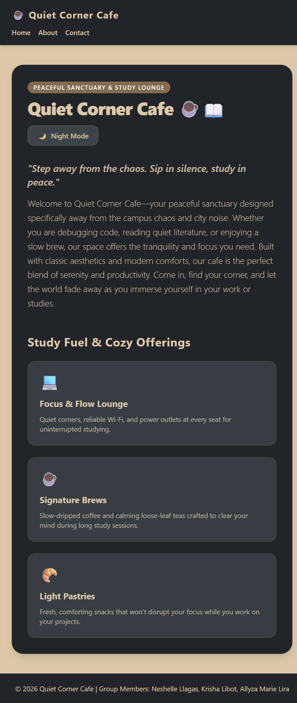
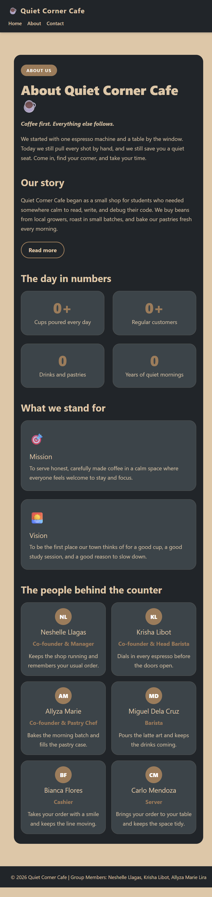
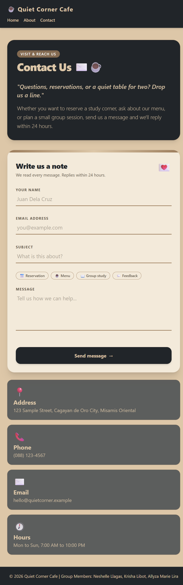

# Quiet Corner Cafe

A Laravel multi-page website for **Quiet Corner Cafe**, a peaceful cafe and study lounge.

## Group information

- **Group name:** Quiet Corner Cafe
- **Section:** IT110-EULM1
- **Members and assigned modules:**

| Member | Module | Branch |
| --- | --- | --- |
| Neshelle Llagas | Project setup, shared layout, and Home page | `dev-member1-Llagas` |
| Krisha Libot | About page | `dev-member2-Libot` |
| Allyza Marie Lira | Contact page | `dev-member3-Lira` |

## Pages

- **Home (`/`)** — Cafe introduction, featured offerings, and a night/day theme toggle.
- **About (`/about`)** — Cafe background, mission and vision, team cards, animated counters, and a Read More / Read Less toggle.
- **Contact (`/contact`)** — Contact details and a form with client-side validation and a success message.

## Screenshots

### Home



### About



### Contact



## Requirements

- PHP 8.3+
- Composer
- Node.js and npm (only needed if installing/building frontend dependencies)

## Run locally

From the project directory:

```sh
composer install
```

Create the local environment file and application key:

```sh
cp .env.example .env
php artisan key:generate
```

The default database connection is SQLite. Create the database file if it does not exist, then run migrations:

```sh
touch database/database.sqlite
php artisan migrate
```

On Windows PowerShell, use this equivalent command:

```powershell
if (-not (Test-Path database\database.sqlite)) { New-Item database\database.sqlite -ItemType File }
php artisan migrate
```

Start the development server:

```sh
php artisan serve
```

Open the local URL printed by Artisan (usually `http://127.0.0.1:8000`).

Run the test suite with:

```sh
php artisan test
```
